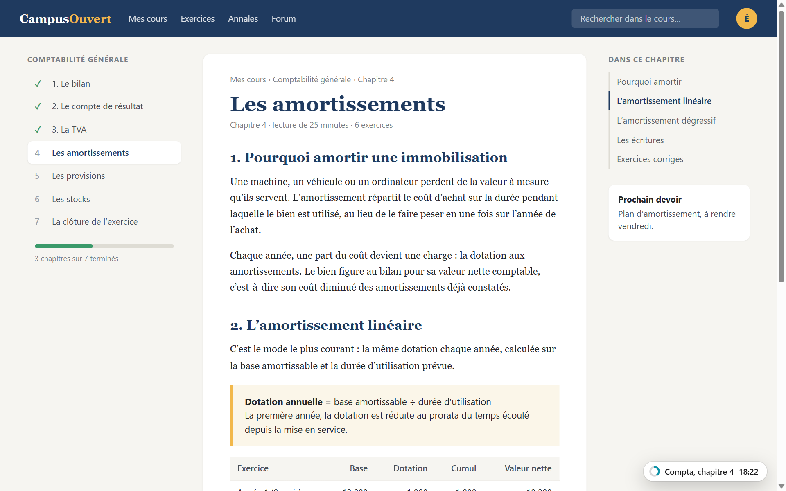
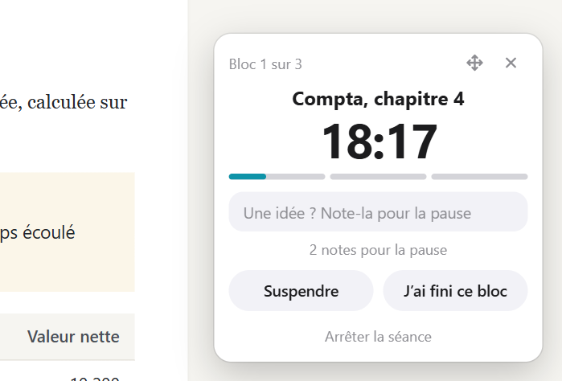
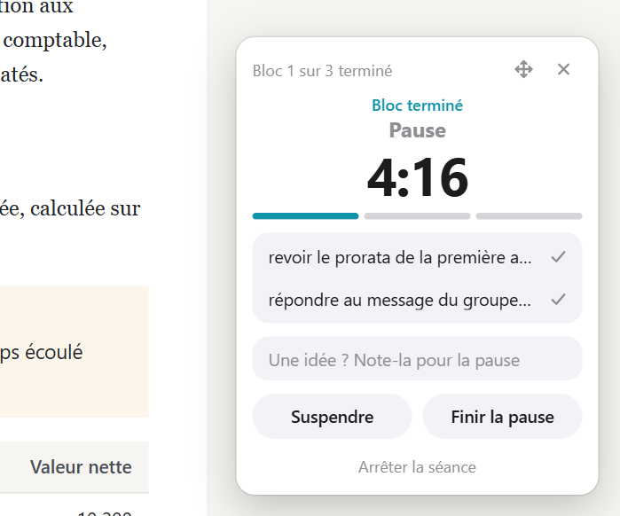
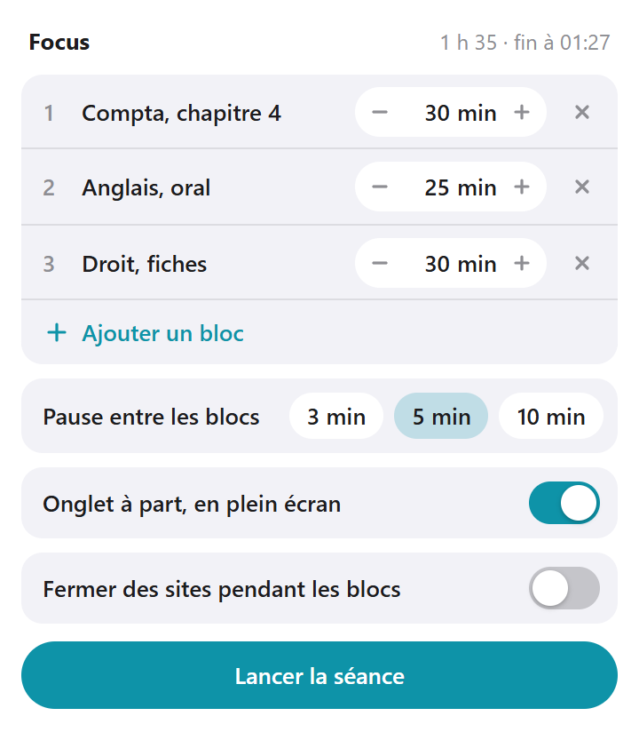
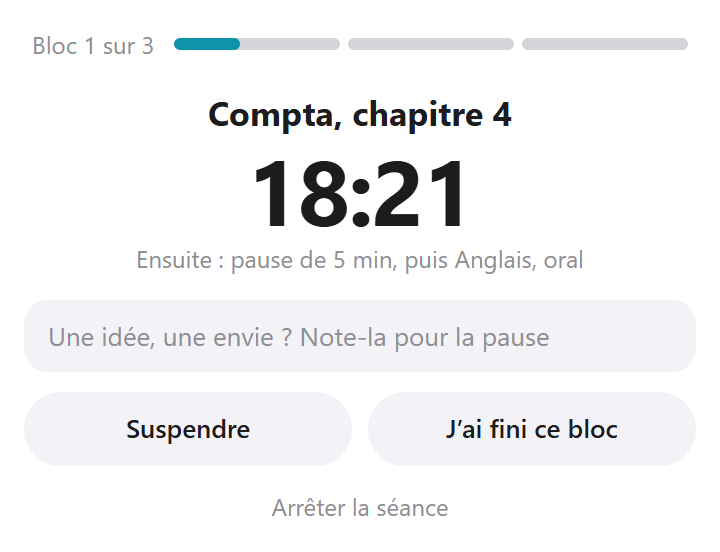
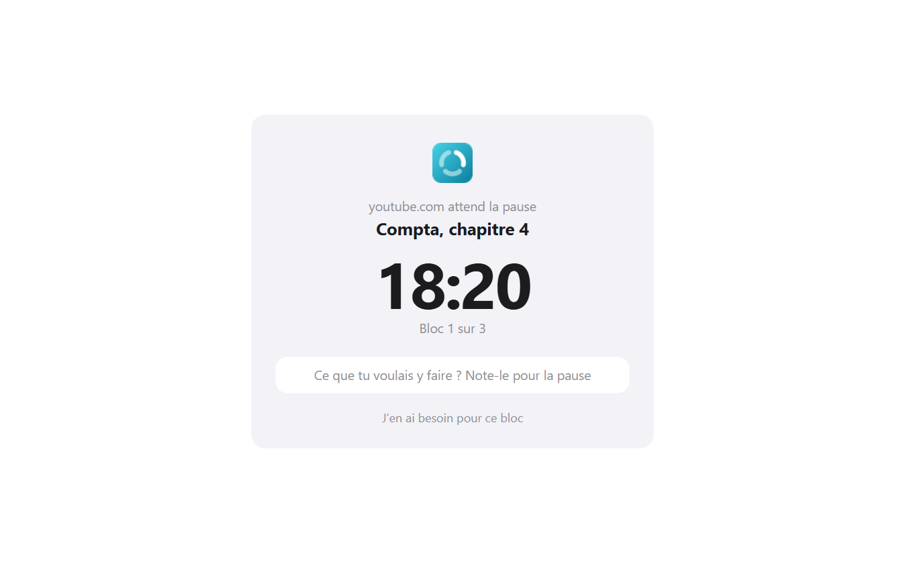

# Focus

A Chrome extension for working in blocks: one task per block, fixed breaks, the tab you work in pulled out into its own full-screen window, and a small timer that follows you on every page.

## What it does

- **A session is a relay of blocks.** You write the tasks before starting (30 minutes of accounting, 25 of English, 30 of law), choose the break between them, and start. Blocks and breaks then follow each other by themselves: nothing to decide during the session.
- **The tab leaves into its own window.** At the start, the tab you are looking at moves alone into a new full-screen window, without being reloaded. The other tabs stay where they were. At the end it goes back to its place, followed by the tabs opened meanwhile.
- **The timer follows.** A pill in a corner of every page shows the task and the time left. A click opens a card to finish the block early, suspend, stop (two clicks), or move the pill to another corner.
- **Later.** An idea or an urge that comes up during a block is typed in the card and kept for the break, where the card lists it.
- **Announcements.** At each break, restart and end, the card opens by itself for a few seconds, and a notification is sent.
- **Closing sites, if wanted.** A switch, off by default, replaces a list of sites (YouTube, Instagram and so on) with a Focus page during blocks and gives them back at the break. A site that is really needed can be reopened for the block after a ten-second wait.

 

  

The interface is in French. The course site in the screenshots is made up for the demonstration.

## Install

The extension is not on the Chrome Web Store, so it is loaded by hand:

1. Download this repository (**Code**, then **Download ZIP**) and unzip it, or clone it.
2. Open `chrome://extensions` and turn on **Developer mode**.
3. Click **Load unpacked** and choose the folder.

## How it works, and what that means

- **Nothing runs outside a session.** The timer pill is a script that Focus registers when a session starts and removes when it ends. Between sessions no script is added to any page, and browsing does not wake the extension.
- **The time is the clock's, not a counter's.** A block ends at a fixed time kept in storage. Closing the popup, sleeping the computer or restarting the extension does not lose it.
- **Pages where the pill cannot be drawn.** Chrome does not let extensions draw on its own pages (new tab, settings, the Web Store). When a session is started from such a page, Focus does not go full screen, because without the pill and without the toolbar there would be no way to act, and the popup says why.
- **It cannot hold you.** `F11` leaves full screen, and another application is one `Alt+Tab` away. Focus cannot do anything about the phone on the desk or about programs other than Chrome.
- **Closing sites is a redirect, not a filter.** The address of the tab is checked when a page opens; a listed site embedded in another page (a video inside a course) keeps working.
- **Staying visible.** If a page hides the pill or opens something full screen over it, the pill restores itself and comes back in front within a second.

## Does it help?

It is a tool for structure, not a treatment, and no study shows that an extension like this one improves concentration. The design leans on a few modest results: in one study of 87 students, fixed breaks left them less tired and less distracted than breaks taken at will, for the same work done ([Biwer et al., 2023](https://pubmed.ncbi.nlm.nih.gov/36859717/)), though a later study found no difference; and writing down a plan in advance for a distraction ("if I want my phone, then I note it and finish the block") helped children with ADHD resist an impulse in laboratory tasks ([Gawrilow & Gollwitzer, 2008](https://www.socmot.uni-konstanz.de/publications/implementation-intentions-facilitate-response-inhibition-adhd-children)).

## Privacy

Everything stays in the browser's local storage: the plan, the session in progress, the notes, and a count of the blocks finished today. Focus has no server and makes no network request.

| Permission | Why it is needed |
| --- | --- |
| Access to `http` and `https` pages, and `scripting` | Draw the timer pill on the pages you visit during a session. This is why Chrome says the extension can read and change data on all sites |
| `storage` | Keep the plan, the session and the notes |
| `alarms` | End each block and each break on time, and update the minutes on the toolbar icon |
| `notifications` | Announce breaks, restarts and the end of the session |
| `webNavigation` | See the address a tab is opening, to close the listed sites during a block. Only listened to while that option is on and a block is running |

## License

[MIT](LICENSE) © 2026 Yanis Arris
